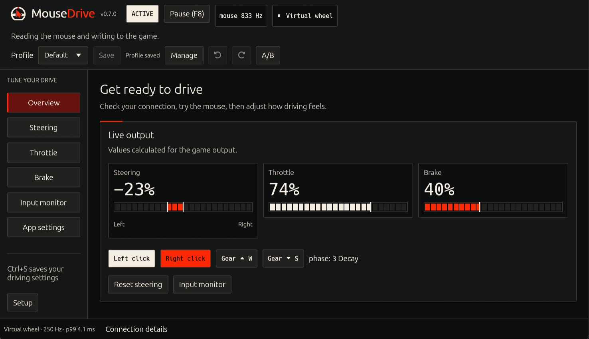

<p align="center">
  <picture>
    <source media="(prefers-color-scheme: dark)" srcset="MouseDrive/image/logo-dark.png">
    
  </picture>
</p>

# MouseDrive (Rust) — v0.7.0

[](https://github.com/MouseDrive/MouseDrive/actions/workflows/ci.yml)
[](https://github.com/MouseDrive/MouseDrive/releases/latest)
[](https://github.com/MouseDrive/MouseDrive/releases)
[](#requirements)
[](#build)
[](LICENSE)

MouseDrive converts mouse and keyboard input into virtual joystick signals for racing simulators: through [vJoy](https://github.com/BrunnerInnovation/vJoy) on Windows and through the kernel's uinput on [Linux](#linux).

[Old C++ version](https://github.com/Toxpox/MouseDrive-old-cpp)

<p align="center">
  
</p>

## Download

**[Download latest release](https://github.com/MouseDrive/MouseDrive/releases/latest)**

Or browse all versions at [Releases](https://github.com/MouseDrive/MouseDrive/releases/).

> **Windows:** extract `MouseDrive-vX.Y.Z-windows-x64.zip`, place `vJoyInterface.dll` next to `mousedrive.exe`, and run. Each release also has `mousedrive.exe` on its own.
>
> **Linux:** extract `MouseDrive-vX.Y.Z-linux-x64.zip`, run `./mousedrive` in the `MouseDrive-vX.Y.Z` folder and follow the one-time [Linux setup](#linux). The `.deb` (Debian, Ubuntu) and `.rpm` (Fedora, openSUSE) packages, and the AUR package `mousedrive-bin`, install the mouse and `/dev/uinput` rule (not the optional keyboard rule), the `uinput` module setting, the menu entry and the icon for you and are updated by the package manager; see [packaging/README.md](packaging/README.md).
>
> `SHA256SUMS.txt` lists the checksums of every file.

## Features

**Driving**

- **Steering** — Mouse X movement mapped to the virtual X axis with 5 modes: *Linear*, *Expo* (soft centre), *Smoothed* (time constant in ms), *Self-centering* and *Adaptive* (One Euro filter: smooth when slow, little lag when fast). Filters are time-based, so the feel does not change with the loop rate.
- **Lossless mouse counts** — Raw counts are accumulated without rounding or per-event caps (only a ±16.7 million count safety limit between ticks); an optional *steering speed limit* (%/s of full lock, off by default) caps how fast the wheel may move. Movement above the limit is delayed, never dropped: the wheel catches up afterwards. Limited ticks are counted in diagnostics.
- **Steering speed in cm** — Shows how many centimetres of mouse travel give full lock; type a distance to set the speed. A built-in *DPI measure* tool finds your mouse DPI with a ruler; the measurement ends by itself when the mouse rests, so moving back to the window is not counted.
- **Throttle** — Left mouse button with rise/drop times, envelope curves and an optional *throttle cut in corners* summarised as a sentence and a mini chart.
- **Brake** — Right mouse button with a five-phase envelope (fill, full pressure, decay while held, short hold after release, release), an optional trail floor that rises with steering, and a **brake ceiling** (max output %) that scales every phase. A live timeline simulated by the real logic shows what the game will receive.
- **Graphical curve editors** — Drag-point envelope editors (2–8 points, linear or smooth/monotone-cubic) with presets, a live marker, numeric entry and full keyboard control.
- **Gear buttons** — Configurable keys (default W/S) mapped to virtual buttons 1/2.

**Profiles and tuning workflow**

- **Profiles** — Driving settings per car/track in `profiles\<name>.toml` (shareable; app settings stay in `config.toml`). Save, save as, duplicate, rename, delete; an unsaved-changes dot and a prompt before switching.
- **Undo / redo** (Ctrl+Z / Ctrl+Y or Ctrl+Shift+Z), *Revert to saved*, per-setting *reset to default*.
- **A/B comparison** — Keep the current settings as A, edit B, and switch with a hotkey while driving. Profile and A/B switches apply only when both pedals are released.

**Feedback and diagnostics**

- **One clear status** — ACTIVE, PAUSED, SETUP REQUIRED, DEVICE BUSY, CONNECTION LOST, MOUSE NOT READ, DEGRADED or BINDING, each with a sentence and a one-click action. Derived on the control thread, so it is correct even while minimised. On Linux, SETUP REQUIRED also appears when no mouse can be read, and PAUSED while the screen is locked or another user's session is in front: nothing you type or click reaches the game, pedals are released, and MouseDrive continues by itself afterwards.
- **Status sounds** — Distinct tones for capture on/off, warnings, connection lost/restored, profile change. Work in exclusive fullscreen and VR.
- **Input monitor** — Scrolling 5/10/30 s chart of mouse input against the values sent to the game, with capture and profile markers and a freeze button. *Save last 30 s as CSV* writes every sample to a file in the log folder, headed by the app version and the active profile settings.
- **Setup and health check** — ✔/⚠/✖ list (Windows: DLL, driver, version match, device, axes, buttons; Linux: uinput, permissions, virtual wheel, whether games can read it, mouse access, keyboard access) with a "how to fix" for every failure, a live axis test and next steps. On Linux it also shows the setup commands, each step explained in one sentence.
- **Axis bind helper** — Countdown, then only the chosen axis or button moves, so the game binds the right one.
- **Automatic reconnect** — Retries when the virtual device is fixed or re-plugged; a vJoy removal notice or repeated write failures switch to CONNECTION LOST and it recovers on its own.
- **Stuck-button guard** — If Windows swallows a button release (UAC prompt, Ctrl+Alt+Del, lock screen), the pedal is released automatically. On Linux the input thread re-reads the buttons from the kernel about every 100 ms while a pedal is held and after the kernel reports lost events, and releases a pedal whose release it missed; diagnostics count both cases.
- **Diagnostics line** — The output, measured loop rate and p99 at a glance; write failures and reconnects appear only when they happen. *Connection details* adds write counts, speed-limited ticks, mouse rate, thread priority and timing (wake-up delay, tick work, input age: median, p99, maximum), and *Copy diagnostics* puts a bug-report summary on the clipboard. On Linux the summary also names the distribution, kernel, glibc, desktop and session type, every input device with its class and why it is not used, lost-event and released-button counts, and whether the single-instance lock is held, portable mode is on and the test options are set; Bluetooth addresses are masked.
- **Mouse selection** — Read all mice or only one device ("pick the last moved mouse"). If the selected mouse is not found, no mouse is read until it is back, you pick it again or you choose *Use all mice* (this clears the selection). On Linux, when the selected mouse is missing and exactly one mouse of the same model shows up on another port, MouseDrive reads that mouse and offers a **Save** button to keep it selected (two identical mice are not guessed between), and it warns when a tool such as input-remapper, keyd or evsieve has grabbed the selected mouse. Touchpad movement does not steer, and the touchpad of a game controller (DualShock, DualSense) is skipped, so its clicks no longer act as throttle.

**App**

- **Decoupled control loop** — A dedicated high-priority 250 Hz thread (on Linux real-time where the system allows it, see [Priority and timing](#using-it)) owns the virtual device and writes all axes in **one report per tick** (no torn frames); the window can be minimised or stall without affecting the output.
- **Safe config** — Config and profile saves are atomic (`.tmp` then rename) and run in order on a background thread, so a slow disk never freezes the window; whatever is still waiting is written before MouseDrive quits. Out-of-range values are corrected and reported by name, unreadable files backed up (a plain copy) instead of overwritten.
- **Accessibility** — Colour-blind palette (Okabe-Ito), brake always dashed in charts, screen-reader labels on custom widgets, status changes announced by screen readers (urgently for SETUP REQUIRED and CONNECTION LOST), rebindable hotkeys (including mouse side buttons; click the key button again or press Esc to cancel, listening stops after 10 s), interface scale 75–200 % (also Ctrl+Plus, Ctrl+Minus and Ctrl+0, saved like the slider).
- **Auto-update** — Background check against GitHub releases with one-click self-update for the matching OS and CPU (download → SHA-256 check, plus the minisign signature once releases are signed → test run with `--version` → replace, keeping the previous binary as `mousedrive.old` (`mousedrive.exe.old` on Windows) until the new version has started → restart; if the new version does not start, the previous one is put back). Package-manager installs (under `/usr` except `/usr/local`, or `/nix/store`) and AppImages only get a link to the release page; a folder MouseDrive cannot write to is reported before anything is downloaded. HTTPS goes through the HTTP proxy named in `https_proxy`, `all_proxy` or `http_proxy` (SOCKS proxies are not supported; hosts in `no_proxy` are reached directly) and, on Linux, also trusts the system certificates. The restart asks first about unsaved profile changes and never happens while another window, such as the game, is in front.
- **Languages** — Turkish and English.

## Input / Output mapping

| Input | Virtual joystick | Control |
|-------|------------------|---------|
| Mouse X movement | X Axis | Steering |
| Left mouse button (held) | Y Axis | Throttle |
| Right mouse button (held) | Rz Axis (Z under Proton/Wine) | Brake |
| Gear up key (default W) | Button 1 | Gear up |
| Gear down key (default S) | Button 2 | Gear down |
| Middle click | — | Reset steering |
| Capture key (default F8) | — | Toggle input capture |
| A/B key (unset by default) | — | Switch between A and B settings |

All keys can be reassigned in **App settings → Keys**.

## Quick start

1. **Windows:** install [vJoy](https://github.com/BrunnerInnovation/vJoy) and enable a device with **X / Y / Rz** axes and **2 buttons** (Device 1 by default). **Linux:** run the one-time [Linux setup](#linux).
2. Run [MouseDrive](https://github.com/MouseDrive/MouseDrive/releases/latest). If anything is missing, the **Setup** window lists what to fix.
3. Bind the axes in your game with the **Axis bind helper**.
4. Set the game's deadzone to 0, linearity to 1 and filtering off — see [In-game settings](#in-game-settings).

`vJoyInterface.dll` is searched next to the exe, then in `Program Files\vJoy\x64`, then on the standard DLL path. If several copies exist, the one matching the installed driver version is used.

## Linux

MouseDrive runs natively on x86-64 Linux. It reads mice and keyboards through **evdev** and creates a virtual joystick, **MouseDrive Virtual Wheel**, through **uinput**, so no extra driver is needed. Games see it like any other wheel, including Windows games under Proton or Wine.

### One-time setup

MouseDrive needs two permissions: to create the virtual wheel through `/dev/uinput` and to read your mouse. The **Setup** window shows these commands with a one-sentence explanation for each step; **Copy setup commands** puts them on the clipboard. They work in bash, zsh and fish:

```sh
sudo modprobe uinput
echo uinput | sudo tee /etc/modules-load.d/mousedrive.conf
printf '%s\n' \
  'KERNEL=="uinput", SUBSYSTEM=="misc", OPTIONS+="static_node=uinput", TAG+="uaccess"' \
  'SUBSYSTEM=="input", KERNEL=="event*", ENV{ID_INPUT_MOUSE}=="1", TAG+="uaccess"' \
  | sudo tee /etc/udev/rules.d/70-mousedrive.rules
sudo udevadm control --reload-rules
sudo udevadm trigger --subsystem-match=misc --subsystem-match=input
```

1. Load the `uinput` kernel module now and at every start.
2. Write `/etc/udev/rules.d/70-mousedrive.rules`: one line for `/dev/uinput`, one for mice (`ID_INPUT_MOUSE`, which also covers the absolute pointers of virtual machines). Keyboards, touchpads and game controllers are not included; touchpad movement does not steer anyway.
3. Apply the rule at once, without logging out.

**What the rule allows.** `TAG+="uaccess"` gives the user of the active local session (systemd-logind) read and write access to the tagged device nodes — for every program that user runs, not only MouseDrive. On a tagged mouse a program can **read** every movement and click, **inject** events of its own and **grab** the device (`EVIOCGRAB`) so that no other program receives its input. On `/dev/uinput` it can create virtual input devices, which is why Steam ships the same uinput line for Steam Input. The access follows the session: it applies at once, moves to whoever uses the local seat and is never given to remote (SSH) sessions.

### Optional: keyboard access

MouseDrive reads the capture key, the A/B key and the gear keys from the keyboard. Without keyboard access those keys do nothing; mouse side buttons still work, so you can bind the capture key to one of them instead. The **Keyboard access** row in Setup shows the state. This step lets MouseDrive **and every program in your session read all keystrokes, passwords included**, inject key presses and grab the keyboard. The rule covers keyboards and other devices with keys, such as media-key nodes, so media keys can be bound too. Add it only if you use keyboard keys:

```sh
printf '%s\n' \
  'SUBSYSTEM=="input", KERNEL=="event*", ENV{ID_INPUT_KEY}=="1", TAG+="uaccess"' \
  | sudo tee /etc/udev/rules.d/71-mousedrive-keyboard.rules
sudo udevadm control --reload-rules
sudo udevadm trigger --subsystem-match=input
```

To remove it, delete `/etc/udev/rules.d/71-mousedrive-keyboard.rules`, run the last two commands again and restart the computer: a keyboard that already got access keeps it until it is unplugged or the computer restarts.

**Upgrading from an earlier version:** the earlier rule tagged every input device (`SUBSYSTEM=="input", KERNEL=="event*", TAG+="uaccess"`), keyboards and game controllers included. While it is installed, Setup shows a **Setup rule** warning. Run the setup commands again (they overwrite `70-mousedrive.rules`), add the keyboard step only if you need it, and restart the computer so the old access ends.

### Other systems

**NixOS:** the files in `/etc/udev/rules.d` come from the system configuration, and `services.udev.extraRules` does not work for this rule: it ends up in `99-local.rules`, which udev applies after the step that grants session access (`73-seat-late.rules`). Add the rule as an early rules package in `configuration.nix` instead and run `sudo nixos-rebuild switch`:

```nix
boot.kernelModules = [ "uinput" ];
services.udev.packages = [
  (pkgs.writeTextFile {
    name = "mousedrive-udev-rules";
    destination = "/lib/udev/rules.d/70-mousedrive.rules";
    text = ''
      KERNEL=="uinput", SUBSYSTEM=="misc", OPTIONS+="static_node=uinput", TAG+="uaccess"
      SUBSYSTEM=="input", KERNEL=="event*", ENV{ID_INPUT_MOUSE}=="1", TAG+="uaccess"
    '';
  })
];
```

- **Without systemd-logind:** use `KERNEL=="uinput", GROUP="input", MODE="0660"` for the first rule, add yourself to the `input` group (`sudo usermod -aG input "$USER"`) and log in again. Note that the `input` group can read every input device, keyboards included.
- **Steam Deck and SteamOS:** set a password with `passwd` first so that `sudo` works; rules in `/etc/udev/rules.d` survive system updates. Steam's own `60-steam-input.rules` already opens `/dev/uinput`, so the virtual wheel can work before you run the setup — Setup then names the rule that allows it, and mouse access still needs the commands above.

### Using it

- **Proton and Wine:** the brake shows up as the **Z** axis, not Rz. Wine hands a joystick's axes to the game in order (X, Y, Z, …) and the wheel has three; native Linux games see the third axis, `ABS_RZ`. Controls a game saved on Windows therefore do not carry over axis by axis — bind the axes again with the **Axis bind helper**.
- **Games can read the virtual wheel:** this Setup row checks that udev marks the wheel as a joystick (`ID_INPUT_JOYSTICK`) and that your session may read it. Without a seat (SSH, some containers) games cannot open it.
- **Wayland:** reading the mouse and the virtual wheel work on X11 and Wayland alike. If the window cannot open through Wayland (for example NVIDIA without `egl-wayland`) while `DISPLAY` is set, MouseDrive restarts itself once through XWayland; start it with `--x11` to use X11 every time.
- **Run it as your normal user, never with `sudo`:** as root it would create settings and log files your user cannot change later, so it refuses to start unless `--allow-root` is given. Mouse access comes from the setup commands above.
- **One instance per user:** a second start shows *MouseDrive is already running* and exits (lock file `$XDG_RUNTIME_DIR/mousedrive.lock`, or the config folder without it). After an update the new version waits a few seconds for the old one to let go.
- **Closing from outside:** `SIGTERM`, `SIGINT` (Ctrl+C) and `SIGHUP` quit MouseDrive cleanly, even when the close button only minimizes it: app settings are saved and the virtual wheel is removed; unsaved profile changes are not saved. A second signal, or a quit that takes longer than 5 s, ends it at once.
- **Close button without minimize:** with *Exit on close* off, × minimizes the window. Compositors that cannot minimize (sway, Hyprland) leave it open; press × a second time within 3 s to quit.
- **Window identity:** the window uses `io.github.MouseDrive.MouseDrive` as its app ID (Wayland) and `WM_CLASS` class (X11), and asks for a dark title bar to match the app.
- **Priority and timing:** the control and input threads ask for more priority at start, in this order. With a real-time limit (`RLIMIT_RTPRIO` above 0, for example from the `realtime` or `audio` group), they run as `SCHED_RR` at priority 10 or your limit, whichever is lower, with a CPU-time budget (`RLIMIT_RTTIME`, 200 ms) so that a thread that never sleeps cannot freeze the desktop: such a thread is moved back to normal priority and diagnostics says so. Without that, the nice value goes down to -10 or as far as `RLIMIT_NICE` allows. If neither works, MouseDrive asks rtkit (RealtimeKit, present on most desktops) over D-Bus. *Connection details* shows the result for both threads, and the wake-up delay, tick work and input age of the control loop. MouseDrive also works without extra priority.
- **Lock screen and user switching:** while systemd-logind reports the session as locked or not in the foreground, MouseDrive reads no mouse or key, sends neutral values and shows PAUSED; it continues by itself when you unlock. A desktop that locks without telling logind may not be detected.
- **See what MouseDrive reads:** `mousedrive --list-devices` prints every input device with its node, vendor and product ID, bus, class (mouse, absolute pointer, touchpad, keyboard, other keys) and either *in use* or the reason it is not used, for example *no permission* or *game controller*. It opens no window and needs no setup: devices your session may not open are listed as *no permission*.
- **Sounds** use ALSA (`libasound.so.2`, also routed through PipeWire or PulseAudio). Without it MouseDrive runs silently.
- **Check what the game receives:** `evtest` (pick *MouseDrive Virtual Wheel*) or `jstest-gtk` shows the raw axes; step by step in [In-game settings](#in-game-settings).

## In-game settings

MouseDrive already shapes the input (steering mode, smoothing, throttle cut, brake envelope). If the game shapes it again, the two stack and the car feels vague, laggy or twitchy — so make the game a straight wire:

| Setting | Value | Why |
|---------|-------|-----|
| Deadzone (steering, throttle, brake) | **0** | A game deadzone hides small corrections; MouseDrive's own (experimental) deadzone is off by default. |
| Linearity / gamma / sensitivity curve | **1 / linear** | Curves belong in MouseDrive (Expo mode, envelope editors). |
| Filtering / smoothing | **off** | MouseDrive's filters are time-based; a game filter adds lag on top. |
| Speed-sensitive steering | **off** | It reduces steering with speed — mouse steering is already precise. |
| Steering rotation / lock | **as the game recommends for the car** | Full mouse travel maps to the game's full lock; *cm per full lock* tells you how far that is. |
| Axis mapping | **separate axes** | Throttle = vJoy **Y**, brake = vJoy **Rz** (Linux under Proton/Wine: **Z**); do not use a "combined pedals" axis. |
| Axis direction | **0 = released** | If a pedal reads inverted, toggle the game's *invert* option for that axis. |

- **Binding:** use the **Axis bind helper** (*Overview → Bind your game controls*, or the *Setup* window). Pick the axis, switch to the game during the 5 s countdown and click the binding row; for the next 4 s only that axis (or gear button) moves.
- **Check what the game receives:** *Set up USB game controllers* (`joy.cpl`) → vJoy Device → *Properties* shows the raw axes. If they are right but the car is not, the problem is a game setting.
- **Check what the game receives on Linux:**
  1. Start MouseDrive and turn capture on.
  2. Run `evtest` in a terminal (package `evtest`) and type the number shown next to **MouseDrive Virtual Wheel**. Steering moves `ABS_X`, throttle `ABS_Y` and brake `ABS_RZ`; gear up presses `BTN_TRIGGER` and gear down `BTN_THUMB`. Stop it with Ctrl+C.
  3. For a graphical view, install `jstest-gtk`, double-click **MouseDrive Virtual Wheel** and watch the axis bars while you steer, accelerate and brake.
  4. Under Proton or Wine, `protontricks -c 'wine control joy.cpl' <appid>` (plain Wine: `wine control joy.cpl`) shows what the Windows game sees; the brake axis is listed as **Z** there.
  5. If the values are right but the car is not, the problem is a game setting.
- Prefer the game's *wheel* input mode over *gamepad* mode: gamepad modes often add their own steering assist and filtering.

## How it works

- **Input thread** — On Windows a hidden window receives `WM_INPUT` for mouse counts and buttons (also while the game has focus); on Linux one thread polls every evdev mouse and keyboard node and follows hotplug through inotify. Counts are accumulated losslessly; scaling happens later in floating point.
- **Control thread** — A dedicated high-priority loop (250 Hz by default) owns the virtual device. Each tick runs the pure driving logic on a logical clock and writes one complete report. Status, sounds, telemetry and the stuck-button guard live here too.
- **GUI thread** — eframe/egui reads a snapshot at the start of each frame and publishes config changes with an epoch counter at the end; it never waits for the control thread. Repaint follows the data: ~60 Hz while the shown values change, ~7 Hz when they stand still, ~4 Hz in the background.
- **Output backend** — The logic produces a normalised frame; the backend (vJoy on Windows, uinput on Linux) maps it to its axis range. This keeps a future own driver or USB dongle a drop-in replacement.

## Requirements

**Windows**

- Windows 10/11
- [Executable MouseDrive](https://github.com/MouseDrive/MouseDrive/releases/latest)
- [vJoy driver](https://github.com/BrunnerInnovation/vJoy) installed and enabled (tested with 2.2.2.0)
- `vJoyInterface.dll` available (next to exe, Program Files, or in `PATH`)

**Linux**

- x86-64 with glibc 2.35 or newer (Ubuntu 22.04, Debian 12, Fedora 36 and later)
- The `uinput` module and the one-time [Linux setup](#linux)
- An X11 or Wayland desktop session for the window, and the libraries the window loads at run time. Desktop installs normally have them; if one is missing, MouseDrive names it and the package to install:
  - Debian/Ubuntu: `sudo apt install libxkbcommon0 libxkbcommon-x11-0 libwayland-client0 libwayland-egl1 libegl1 libgl1 libx11-6 libx11-xcb1 libxcb1 libxcursor1 libxi6`
  - Fedora: `sudo dnf install libxkbcommon libxkbcommon-x11 libwayland-client libwayland-egl libglvnd-egl libglvnd-glx libX11 libX11-xcb libxcb libXcursor libXi`
  - Arch: `sudo pacman -S libxkbcommon libxkbcommon-x11 wayland libglvnd libx11 libxcb libxcursor libxi`
- Optional, for sounds: ALSA (`libasound2` / `libasound2t64` on Debian/Ubuntu, `alsa-lib` on Fedora and Arch)

## Build

`rust-toolchain.toml` pins the toolchain (Rust 1.98.0 with clippy and rustfmt); rustup installs it on the first `cargo` call. The minimum supported Rust version is 1.95 (`rust-version` in `MouseDrive/Cargo.toml`).

```powershell
cargo build --release --manifest-path MouseDrive/Cargo.toml
# without the auto-updater (smaller binary, no network code)
cargo build --release --manifest-path MouseDrive/Cargo.toml --no-default-features
```

Checks run by CI (see `.github/workflows/ci.yml`) with the pinned toolchain; every command that resolves dependencies uses `--locked`:

```powershell
cargo fmt --manifest-path MouseDrive/Cargo.toml --check
cargo clippy --locked --manifest-path MouseDrive/Cargo.toml --all-targets --all-features -- -D warnings
cargo clippy --locked --manifest-path MouseDrive/Cargo.toml --all-targets --no-default-features -- -D warnings
```

On Linux it also runs:

```sh
cargo test --locked --manifest-path MouseDrive/Cargo.toml
cargo test --locked --manifest-path MouseDrive/Cargo.toml --no-default-features
cargo deny --manifest-path MouseDrive/Cargo.toml --locked check
bash .github/scripts/check-packaging.sh
```

`cargo deny` checks security advisories, licenses and crate sources (`MouseDrive/deny.toml` lists the accepted advisories with reasons). A release tag must match the version in `MouseDrive/Cargo.toml` and the newest release in the AppStream metainfo. The Linux release is built in an Ubuntu 22.04 container and fails if the binary needs a glibc newer than 2.35. Packaging files and the `.deb`/`.rpm` setup are described in [packaging/README.md](packaging/README.md).

## Configuration

Settings are stored as TOML in one folder:

1. Next to the exe (portable mode) if an empty `mousedrive.portable` file exists there, or a `config.toml` written by MouseDrive (it has a `config_version` key). A `config.toml` with no MouseDrive keys — another program's file — is never used or rewritten.
2. Otherwise `%APPDATA%\MouseDrive\` on Windows, `~/.config/mousedrive/` on Linux (`$XDG_CONFIG_HOME` is honoured)

| File | Contents |
|------|----------|
| `config.toml` | App settings: language, vJoy device (Windows), keys, mouse, sounds, view, active profile |
| `profiles\<name>.toml` | Driving settings of one profile — copy it to share a setup |
| `mousedrive.log` | Event log: UTC time in milliseconds, level, thread; repeated lines are folded, rotated at 1 MB into `mousedrive.log.old`. Written by a background thread, so the control loop never waits for the disk. On Linux it lives in `~/.local/state/mousedrive/` (`$XDG_STATE_HOME` is honoured; next to the exe in portable mode); a log left in `~/.config/mousedrive/` by an older version is moved there on start |
| `last_crash.txt` | Next to the log: thread, location, message and backtrace of a crash. The next start shows a notice and renames it to `last_crash.old.txt` — attach it to a bug report |
| `mousedrive-monitor-<time>.csv` | *Save last 30 s as CSV* in the input monitor writes it to the log folder; the first lines are `#` comments with the app version and the profile settings |
| `mousedrive.lock` | Empty single-instance lock, released when MouseDrive exits. On Linux it lives in `$XDG_RUNTIME_DIR` (the config folder only when that is not set); on Windows in `%APPDATA%\MouseDrive\`, also in portable mode |

Changes are saved automatically for app settings; profiles are saved with **Save** (Ctrl+S). Saves are atomic (`.tmp` then rename, the folder is flushed on Linux); a symlinked `config.toml` or profile stays a symlink and keeps its permissions. Backups and duplicated profiles are plain copies. Out-of-range values are corrected on load and reported by name; a file that cannot be read is backed up as `<file>.<timestamp>.bak` (once per content); for config.toml the defaults are used, for the active profile the last saved settings stay in use. A `config.toml` from a newer MouseDrive, or one with settings this version does not know, is backed up the same way before anything is written; if that backup fails, settings are not saved in that session. Profile names are matched exactly first and then ignoring letter case; when two profile files differ only in case (`Hypercar.toml`, `hypercar.toml`), a name that matches both is refused instead of guessing. In-game recommendations: [In-game settings](#in-game-settings).

### Command-line options

| Option | Effect |
|--------|--------|
| `--help`, `-h` | Print the options and exit |
| `--version`, `-V` | Print the version and exit |
| `--x11` / `--wayland` | Linux: open the window through X11 (XWayland) or Wayland instead of the automatic choice |
| `--list-devices` | Linux: list the input devices, their class and why any are not used, then exit |
| `--test-counter` | Write a test pattern to the axes instead of the mouse input |
| `--allow-injected` | With a selected mouse, also accept input generated by software |
| `--allow-root` | Linux: start even when run as root (not recommended) |

Unknown options are reported on stderr and in the log, then ignored.

## Project layout

```
MouseDrive/
├── build.rs               # Embeds the app icon and version info in mousedrive.exe
├── deny.toml              # cargo-deny policy: advisories, licenses, sources
├── about.toml, about.hbs  # cargo-about: THIRD_PARTY_LICENSES.html shipped with releases
├── image/                 # Logo, app icon (.svg / .png / .ico), screenshot
└── src/
    ├── main.rs            # App binary: startup/shutdown order, eframe window
    ├── cli.rs             # Command-line options (--help, --version, --x11, --wayland, …)
    ├── preflight.rs       # Start checks: root, desktop session, window libraries, single instance
    ├── lifecycle.rs       # Close on SIGTERM/SIGINT/SIGHUP, one XWayland retry
    ├── ui/                # egui screens: status bar, navigation, overview, settings pages, profiles, monitor, setup, ...
    ├── curve_editor.rs    # Drag-point curve editor widget
    ├── lang/              # TR / EN strings
    ├── update.rs, update/ # Auto-update: release check, SHA-256 + minisign verify, test run, replace and roll back ("updater" feature)
    ├── lib.rs             # Library: all modules below, no GUI
    ├── logic.rs, logic/   # Pure driving logic (steering, throttle, brake) + filters
    ├── curve.rs           # Envelope curve model (PCHIP eval/inverse, point editing, presets)
    ├── control/           # Control thread: engine (tick), connection/reconnect, stuck-button guard, absolute-deadline clock, IO seam
    ├── output.rs          # OutputBackend trait + normalised OutputFrame
    ├── vjoy.rs            # Windows output: vJoy backend (runtime DLL loading, single-report writes, removal callback)
    ├── uinput.rs          # Linux output: uinput virtual wheel
    ├── input.rs, input/   # Input thread: lossless counts, buttons, mouse selection (Raw Input / evdev); Linux: device classes and skip reasons, overflow recovery, hotplug
    ├── keys.rs, keys/     # Key state and names (GetAsyncKeyState / evdev); Linux: logind lock and session state
    ├── config.rs, config/ # Config + Tuning, validation, migration, atomic IO, portable-mode detection
    ├── profiles.rs        # Profile files
    ├── session.rs         # GUI editing session: epochs, undo history, save state
    ├── status.rs          # Status model and sound cue planning
    ├── setup.rs, setup/   # Setup/health check report; Linux: udev rule scan
    ├── telemetry.rs       # Preallocated ring buffer for the input monitor (the control thread skips a sample rather than wait for it)
    ├── diagnostics.rs     # Loop timing, mouse rate, bug-report text
    ├── preview.rs         # Offline simulation for the brake timeline and throttle chart
    ├── bind.rs            # Axis bind helper
    ├── ergonomics.rs      # cm per full lock
    ├── sound.rs, sound/   # Status tones (PlaySound / ALSA)
    ├── priority.rs        # Thread priority outcome and RLIMIT_RTTIME budget (Linux details in platform/linux/: SCHED_RR, nice, rtkit)
    ├── platform.rs, platform/ # Thread priority, timer resolution or slack, signals, alerts, child processes
    ├── instance.rs        # Single-instance lock
    ├── fsutil.rs          # Atomic writes, timestamped backups
    ├── disk.rs            # Background writer thread: config, profile and CSV writes in order, flushed on exit
    ├── crash.rs           # Panic hook: crash report next to the log, notice on the next start
    └── log.rs, log/       # Event log: background writer, repeat folding, bridge for the `log` crate
```

Packaging and release files are in `packaging/` and `.github/` ([packaging/README.md](packaging/README.md)). Release history in [CHANGELOG.md](CHANGELOG.md).

## Troubleshooting

Start with the **Setup** window: it checks every requirement and says how to fix each failure. **Copy diagnostics** (bottom line → *Connection details*) gives a summary to paste into a bug report.

| Problem | Solution |
|---------|----------|
| "vJoyInterface.dll not found" | Install vJoy, or place the DLL next to the exe or in `Program Files\vJoy\x64` |
| DLL and driver versions differ | Remove old `vJoyInterface.dll` copies next to the exe, or reinstall vJoy |
| "vJoy not enabled" | Check that the vJoy driver is installed and enabled (vJoyConf) |
| DEVICE BUSY | Another feeder (Joystick Gremlin, SimHub, UCR…) owns the device — close it or choose another vJoy device in **App settings → Output** |
| CONNECTION LOST | MouseDrive retries every second on its own; after 15 s the status becomes SETUP REQUIRED and it keeps retrying every 2 s. **Reconnect** forces a retry |
| MOUSE NOT READ | Turn on **Read mouse while the game has focus** in **App settings → Mouse**. If the selected mouse is not found, plug it back in, pick it again or click **Use all mice**. On Linux, check **Mouse access** in the Setup window |
| Linux: uinput, permission or mouse access row fails | Run the setup commands shown in the **Setup** window ([Linux setup](#one-time-setup)); they apply within seconds |
| Linux: the capture key or the gear keys do nothing | Keyboard access is optional; see [keyboard access](#optional-keyboard-access), or bind the capture key to a mouse side button |
| Linux: the wheel is off-centre after the system was busy, or *Some mouse input was lost* appears | The kernel dropped mouse events because MouseDrive was not scheduled in time; middle-click to recentre. Held pedals are checked again at once. *Connection details* counts the cases; if it keeps happening, check *Thread priority* there |
| Linux: *Another tool has grabbed the selected mouse* | input-remapper, keyd or evsieve took the mouse and only its virtual copy moves. Exclude the mouse in that tool, or close it |
| Linux: *found on a new port* | The selected mouse is missing and the same model appeared on another port; MouseDrive reads it there for now. Click **Save** to keep it selected, otherwise the old port stays saved |
| Linux: a game controller's touchpad or a laptop touchpad does not steer | By design: touchpads are not read for steering. `mousedrive --list-devices` shows what is used and why |
| Linux: the game does not list the wheel or binds the wrong brake axis | Check *Games can read the virtual wheel* in the Setup window. Under Proton/Wine the brake is the **Z** axis |
| Linux: the window does not open | MouseDrive names missing system libraries in a notification and on stderr ([requirements](#requirements)). If the Wayland window fails, MouseDrive retries once through XWayland; `mousedrive --x11` forces X11. The log (`~/.local/state/mousedrive/mousedrive.log`) has the error |
| "MouseDrive is already running" | Only one MouseDrive runs per user. Use the open window (it may be minimized) or close it first |
| PAUSED | Press the capture key (default **F8**). On Linux, PAUSED with a message about a locked screen or a session that is not in the foreground ends by itself when you unlock or switch back |
| The game binds the wrong axis | Use the **Axis bind helper** |
| Steering feels laggy or has a deadzone | Set the game's deadzone to 0, linearity to 1, filtering off — [in-game settings](#in-game-settings) |
| **Brake or throttle stays pressed after MouseDrive crashed or was killed** | vJoy keeps the last values when the feeding process dies (measured with vJoy 2.2.2.0). Start MouseDrive again: it writes neutral values as soon as it takes the device. A normal exit always leaves neutral values. |
| A pedal stayed pressed after a UAC prompt | Both pedals are released within ~200 ms when a UAC prompt, Ctrl+Alt+Del or the lock screen takes over input. Any other missed release is caught within ~200 ms once Windows has seen the press. The count appears in diagnostics |
| Settings not saving | Check write permissions in `%APPDATA%\MouseDrive\` or `~/.config/mousedrive/` (or the exe folder in portable mode) |

## License

Copyright (c) 2025-2026 [Toxpox](https://github.com/Toxpox).
MouseDrive is free software: you can redistribute it and/or modify it under the terms of the [GNU General Public License](https://github.com/MouseDrive/MouseDrive/blob/main/LICENSE) as published by the Free Software Foundation, either version 3 of the License, or (at your option) any later version.

Releases up to v0.5.0 were published under the MIT License and remain available under it.

The licenses of the libraries and fonts built into a release are listed in `THIRD_PARTY_LICENSES.html`, which is part of every release zip and package.

The license grants no rights to the MouseDrive name or logo (GPL-3.0 section 7(e)). Modified versions must not be presented as the original MouseDrive (section 7(c)).
